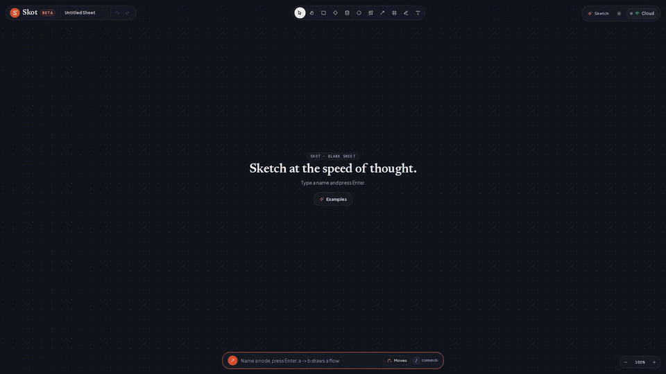
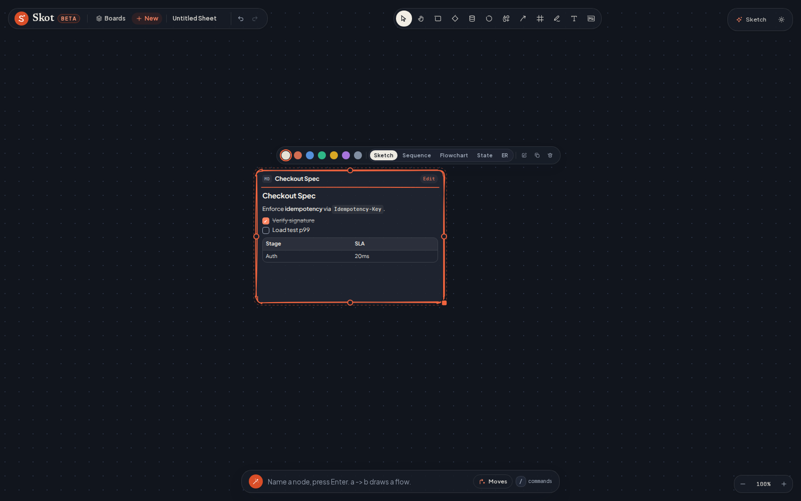

# Skot — sketch at the speed of thought

[](LICENSE)
[](https://skot.lightslips.ai)
[](https://github.com/charles161/skot/actions/workflows/ci.yml)

**Skot** is an open-source, local-first AI architecture whiteboard: **sketch at the speed of thought**. Type a system flow and watch it draw itself, fork any subgraph into 3 architectural takes, morph diagrams losslessly between Sketch / Sequence / Flowchart / State / ER, or paste rich Markdown straight from Notion onto the canvas.

Runs cleanly **100% locally with zero API keys** (honest deterministic heuristics), or pairs with **TypeSafe AI's System One** (`typesafe-ai/jev`) via Vercel AI Gateway.

<p align="center">
  
</p>

## Quick Start (30 seconds)

```bash
git clone https://github.com/charles161/skot.git
cd skot
pnpm install
pnpm dev
```

Open [http://localhost:3000](http://localhost:3000). No accounts, no database, and no API keys required — boards save locally in your browser and every `/` visit starts a clean room.

## Highlights

- **Write-to-Draw Instantaneously (`/` or just start typing)**
  - Type `app` → `Enter` → `server` → `Enter` → `postgres` → `Enter` to chain spaced nodes with smart curved arrows.
  - Type full arrow flows like `Client -> Checkout API -> Fraud Check? -> Postgres` to generate collision-free `SemanticGraph` layouts with inferred shapes (actors, decisions, databases, queues, caches, load balancers, zone frames).
  - Live WYSIWYG ghost preview with `Tab` slot switching before committing.
- **Markdown Note Nodes (`Alt+M` or paste straight from Notion with `⌘V`)**
  - Place a Markdown card from the dock or hit `⌘V` directly on the canvas with blocks copied from **Notion**, Google Docs, or GitHub.
  - Preserves headings, **bold**, *italic*, ~~strikethrough~~, inline `code`, fenced code blocks, nested lists, clickable task checkboxes (`- [x]` / `- [ ]`), blockquotes, safe links, and GFM tables — up to 20 KB per note, connectable with arrows and included in `.svg` exports.
- **Fork It! (`Alt+F` with selection)**
  - Select any node or subgraph to generate **3 distinct architectural takes** (Event-Driven Queue, Cache-First / Read Replica, Edge Split, Circuit-Breaker Mesh) rendered side-by-side beside dimmed originals. Cycle with `Tab` or `1`/`2`/`3`, press `Enter` to swap in place with external edges rewired, `⌘Z` to undo.
- **Reversible Notation Morph (`Sketch` · `Sequence` · `Flowchart` · `State` · `ER`)**
  - Morph any selection between visual notations in place and return to **Sketch** without losing your original geometry, labels, or external arrows.
- **Multi-Room Local Boards & Clean Links**
  - Opening `/` always starts a **fresh blank room** (`/b/<128-bit-id>`). Existing rooms open only via their exact `/b/<id>` URL or the top-bar **Boards** picker; start another room anytime with **+ New**.
  - Export/import portable `.json` board files, copy self-contained `#import=` share links, or restore earlier copies from the rolling recovery buffer.
- **Pure-SVG Export & Studio Craft**
  - Standalone `.svg` export built directly from the board AST (zero DOM clones, handles, or overlays).
  - Toggle **Sketch** (`roughjs` ink) vs **Clean** vector lines, and **Studio Vellum** (light) vs **Midnight Blueprint** (dark).
- **Optional Peer-to-Peer WebRTC Collaboration & Vandalism Recovery**
  - Direct `RTCPeerConnection` + `RTCDataChannel` sync with live cursors, same-origin `BroadcastChannel` tab sync, `>50%` bulk-change quarantine (**Keep** / **Revert**), and constant-time creator reclaim.

<p align="center">
  
</p>

## Keyboard Shortcuts

| Shortcut | Action |
| --- | --- |
| Just type / `/` | Focus the Write-to-Draw Thought Bar |
| `⌘V` / `Ctrl+V` (on canvas) | Paste Notion / rich HTML / Markdown as a formatted Markdown node |
| `Alt+M` | Markdown Note tool |
| `Alt+F` | Trigger **Fork It!** on selected shape(s) |
| `Tab` / `Shift+Tab` | Cycle placement slots, Fork takes, or Top 3 predictions |
| `Enter` | Commit Thought Bar, apply Fork take / ghost prediction, or edit label |
| `1` / `2` / `3` | Jump to (or apply) Fork take or prediction option 1, 2, or 3 |
| `Esc` | Cancel Fork It!, dismiss ghosts, clear Thought Bar, or deselect |
| `←` / `→` or `[` / `]` | Cycle color tone on selected element(s) |
| `F2` | Edit selected element title in place |
| `Alt+S`, `H`, `R`, `D`, `O`, `C`, `A`, `Z`, `P`, `T`, `M` | Select, Hand pan, Box, Decision, Database, Actor, Arrow, Zone Frame, Ink Pen, Text, Markdown |
| `Space + Drag` | Pan canvas |
| `⌘A` / `⌘D` / `⌘Z` / `⌘⇧Z` | Select all · Duplicate · Undo · Redo |

## Tech Stack & Architecture

- **Framework**: Next.js 16 (App Router, Turbopack), React 19, TypeScript 5 (strict), Tailwind CSS v4, `@base-ui/react`, custom hand-drawn inline-SVG icons (`src/brand/icons`, contact sheet at `/icons`), `roughjs`, Zod 4, Vitest 5.
- **Internal naming note**: Internal paths (`src/lib/jev`, `src/components/jev`, `/api/jev/decide`, `JEV_*` env vars, `jev_*` localStorage keys) keep the pre-rename `jev` identifier so existing deployments and saved boards keep working seamlessly.
- **Core modules**:
  - `src/lib/jev/` — `semantic-graph.ts`, `diagram-parser.ts`, `placement-engine.ts`, `fork-engine.ts`, `notation-morph.ts`, `markdown.ts`, `boards.ts`, `rough-paths.ts`, `svg-export.ts`, `webrtc-collab.ts`, `sync-validation.ts`.
  - `src/components/jev/` — `JevWorkspace.tsx`, `JevCanvas.tsx`, `MarkdownNodeView.tsx`, `MarkdownNodeEditor.tsx`, `MyBoards.tsx`, `ForkHud.tsx`, `NotationMorphBar.tsx`, `ThoughtBar.tsx`.
  - `src/app/api/` — `/api/jev/decide`, `/api/jev/moves`, `/api/signal`, `/api/ice-config`, `/api/health`.

## Environment Variables (All Optional for Local Dev)

Copy `.env.example` to `.env.local` if you want to enable AI Gateway suggestions or self-hosted WebRTC TURN. With zero env vars, Skot runs in honest `"Heuristic"` mode.

| Variable | Required | Description |
| --- | --- | --- |
| `TRUST_PROXY` | **Prod only** | Client IP resolution for rate limits: `cloudflare` (`CF-Connecting-IP`) or `none` (direct peer IP / `ALLOW_SINGLE_USER_LOCAL=1`). |
| `ALLOW_SINGLE_USER_LOCAL` | Optional | Set to `1` with `TRUST_PROXY=none` for local single-user production runs. |
| `AI_GATEWAY_API_KEY` | Optional | Vercel AI Gateway key powering `typesafe-ai/jev` decisions and LLM refinement. On Vercel, OIDC (`x-vercel-oidc-token`) authenticates automatically. |
| `AI_GATEWAY_MODEL` | Optional | Override default per-route model (`anthropic/claude-haiku-5.5` / `openai/gpt-4.1-mini`). Per-route overrides: `AI_GATEWAY_MODEL_<ROUTE>`. |
| `JEV_MODEL` | Optional | AI Gateway decision model id (default `typesafe-ai/jev`). |
| `TYPESAFE_API_KEY` | Optional | Direct TypeSafe AI key fallback when no AI Gateway credential is set. |
| `SITE_URL` | Optional | Canonical origin for Open Graph previews (e.g. `https://skot.lightslips.ai`). |
| `TURN_SHARED_SECRET` / `TURN_URLS` | Optional | Short-lived HMAC-SHA1 coturn credentials minted via `/api/ice-config` for authenticated P2P peers. |
| `JEV_UPSTREAM_MAX_PER_MINUTE` / `_DAY` | Optional | Global upstream call caps for `/api/jev/decide` (defaults `120`/min, `5000`/day). |

## Security Model

- **Strict CSP (`src/proxy.ts`)**: Per-request cryptographic CSP nonces (`script-src 'self' 'nonce-...' 'strict-dynamic'`), `X-Content-Type-Options: nosniff`, `X-Frame-Options: DENY`, `Referrer-Policy`, `Permissions-Policy`.
- **Client-side Secrets**: Board IDs are `>=128-bit` random tokens at `/b/<id>`. Room secrets stay in the browser (or URL `#k=` fragment for self-hosted P2P links) and never touch server logs or referrers.
- **Zero-XSS Markdown & SVG**: Markdown parsing uses a pure allowlisted AST (links restricted to `http:`, `https:`, `mailto:`); SVG exports serialize through a strict tag/attribute allowlist.
- **Hardened APIs**: Strict Zod schemas, prototype-pollution key checks, byte-stream caps, sliding-window rate limits, and `Cache-Control: no-store`.

## Development, Tests & Self-Hosting

```bash
pnpm install
pnpm dev             # local dev server (http://localhost:3000)
pnpm test            # 2,180+ Vitest unit & API security tests
pnpm typecheck       # next typegen + strict tsc --noEmit
pnpm run lint        # ESLint

# Local production build & run
TRUST_PROXY=none pnpm build
TRUST_PROXY=none ALLOW_SINGLE_USER_LOCAL=1 pnpm start -p 4311

# Full Playwright end-to-end feature suite (verify/features.yml)
python3 -m pytest verify/features --launch -v
```

## Contributing & License

Contributions are welcome — see [CONTRIBUTING.md](CONTRIBUTING.md). Licensed under the **Apache License 2.0** ([LICENSE](LICENSE) · [NOTICE](NOTICE)).
